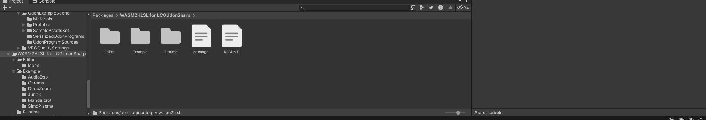
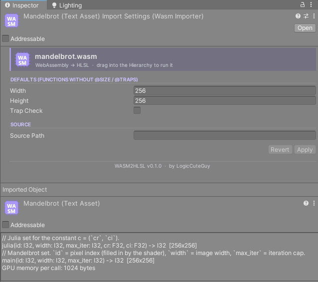
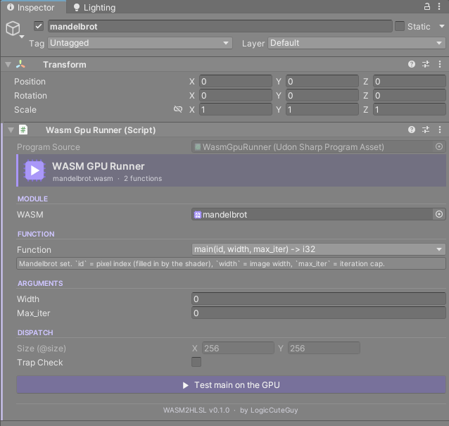
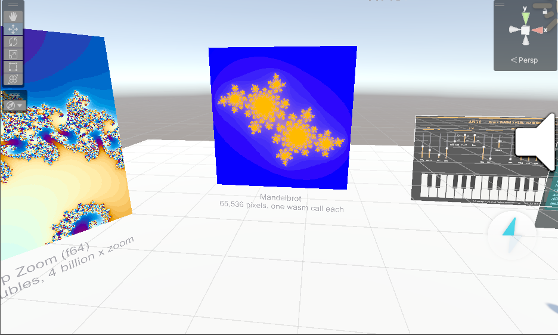
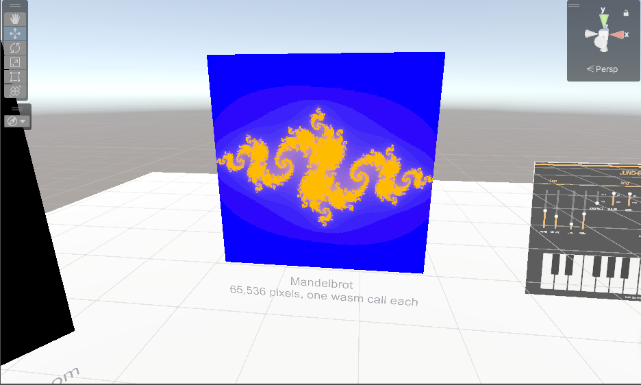
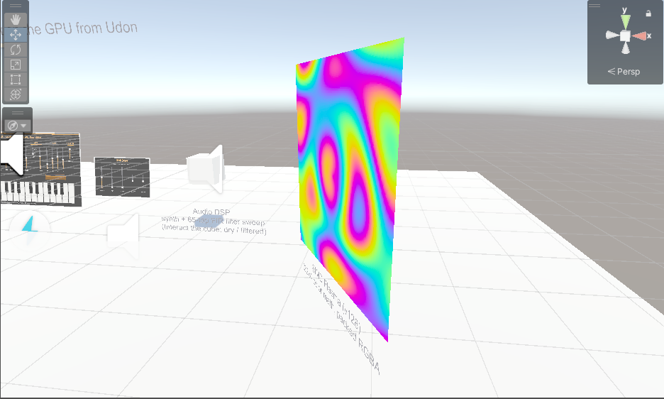
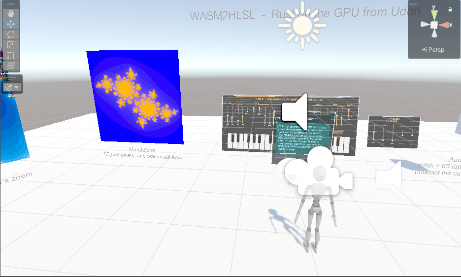

# WASM2HLSL: Getting Started

WASM2HLSL turns a `.wasm` file into an HLSL pixel shader. An UdonSharp `WasmGpuRunner` runs an exported
function **once per pixel** of a render texture and reads the results back into Udon.
Use it for heavy loops (DSP, fractals, filters) that are far too slow in Udon.


## 1. Install

Add the package through VPM or copy `com.logiccuteguy.wasm2hlsl` into `Packages/`.
Requires VRChat Worlds SDK 3.10.5 and `com.logiccuteguy.lcgudonsharp` >= 0.3.10.



## 2. Write a kernel

Parameter 0 (if `i32`) is the pixel index. The doc comment becomes the inspector help;
`@size W x H` sets calls per `Run()`, `@traps` enables Trap Check.

```rust
#![no_std]
#[panic_handler] fn panic(_: &core::panic::PanicInfo) -> ! { loop {} }

/// Multiplies the pixel index by `scale`.
/// @size 256x256
#[no_mangle]
pub extern "C" fn main(id: i32, scale: i32) -> i32 { id * scale }
```

Build with a small stack (GPU memory lives in registers):

```bash
RUSTFLAGS="-C link-arg=-zstack-size=4096 -C target-cpu=mvp -C target-feature=+bulk-memory,+sign-ext,+nontrapping-fptoint" cargo build --release --target wasm32-unknown-unknown
```

## 3. Import and place

1. Copy the `.wasm` into `Assets/`. The shader, material and render texture are created *inside* the asset
   (expand it in the Project window). Selecting it shows the importer: default Width/Height/Trap Check for
   functions without `@size` / `@traps`, an optional **Source Path** for argument names, and a summary of every
   exported function with its size and GPU memory per call.

   

2. Drag the `.wasm` into the Hierarchy or Scene view. You get a GameObject with a configured `WasmGpuRunner`.
   Pick the **Function** to run, fill its **Arguments**, and check **Size** and **Trap Check**
   (both locked when the source sets them with `@size` / `@traps`).

   

3. Press **Test** in the inspector to run the function on the GPU without entering Play Mode.

## 4. Call it from UdonSharp

```csharp
public WasmGpuRunner runner;
void Start()
{
    runner.callbackTarget = this;
    runner.SetFunction("main");
    runner.SetNamedArgInt("scale", 3);
    runner.Run();
}
public void OnWasmComplete() { Debug.Log(runner.resultLo[0]); }
```

One function runs at a time per runner (`busy`).

## 5. Try the examples

Open `Example/Showcase.unity` and press Play. It contains Mandelbrot, a Juno-6 synth, AudioDsp,
DeepZoom (f64) and SimdPlasma (v128).



For DeepZoom and SimdPlasma, run **Tools > WASM2HLSL > Add f64 + SIMD Examples To Scene** once, then save the scene.

## Use cases

Anything that is the same small computation over many independent inputs fits: one pixel (or one call) per item.

| Use case | Example | What the GPU does |
|---|---|---|
| Procedural images | Mandelbrot / Julia | 65,536 pixels, one wasm call each, result drawn from the render texture. |
| High precision math | DeepZoom (f64) | Doubles emulated in integer math: a 4 billion x zoom on Quest-compatible GPUs. |
| SIMD / vector code | SimdPlasma (v128) | `f32x4` colour math packed into RGBA. |
| Audio synthesis and DSP | Juno-6 synth, AudioDsp | One call per audio sample (`@size 48000`), read back into an `AudioClip`; a 65-tap FIR filter sweep. |
| Video and image filters | Chroma | Live scale filter inserted between the synth and a video player. |







## Limits

No recursion, writable memory <= 64000 bytes (constant `static` tables are read from a texture and don't count),
`memory.grow` always fails, f64 is slow and compiles slowly,
no threads/exceptions/GC. Pixels are independent; return values are the only output.
See the package [README](../README.md) for the full table and test notes.
