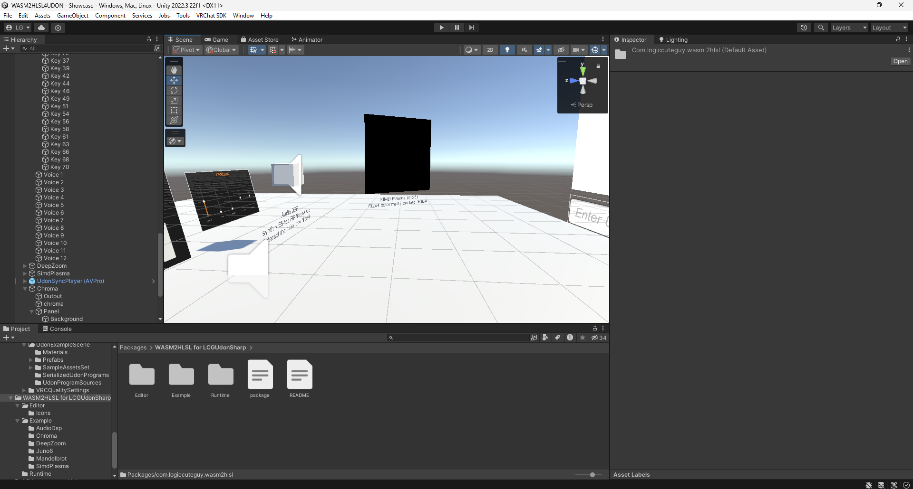

# WASM2HLSL for LCGUdonSharp

Run WebAssembly on the GPU in a VRChat world. Drop a `.wasm` file into the project and the editor
translates it to HLSL; an UdonSharp `WasmGpuRunner` then executes the exported function **once per pixel**
of a render texture and reads the results back into Udon.



See [Documentation~/GettingStarted.md](Documentation~/GettingStarted.md) for a step-by-step guide.

## Install

VRChat Worlds SDK 3.10.5 and `com.logiccuteguy.lcgudonsharp` >= 0.3.10 are required. Add this repository as a package
(Unity Package Manager > Add package from git URL, or clone it into `Packages/`).

Udon is slow (roughly 1000× slower than C#). A pixel shader running the same logic over thousands
of pixels in parallel is not. This package lets you write that logic in Rust/C/Zig instead of hand-written HLSL.

## Pipeline

```
kernel.rs ──rustc──▶ kernel.wasm ──(import)──▶ inside the .wasm asset, per export: shader + material + render texture
WasmGpuRunner (U#): args/SetInput → VRCGraphics.Blit → VRCAsyncGPUReadback → int[] resultLo
```

## Quick start

1. Write a kernel. Parameter 0 (if `i32`) receives the pixel index; the others are arguments you set from Udon by name.
   Export as many functions as you like. The comment above each one is its inspector help, and two tags set it up:
   `@size W x H` (or `@size N` for N calls) is how many calls one `Run()` makes, and `@traps` turns on Trap Check.

   ```rust
   #![no_std]
   #[panic_handler] fn panic(_: &core::panic::PanicInfo) -> ! { loop {} }
   #[link(wasm_import_module = "env")]
   extern "C" {
       fn input(i: i32) -> i32;        // optional: reads SetInput() data
       fn hlsl_sin(x: f32) -> f32;     // optional: native GPU math
   }

   /// Multiplies each input word by `scale`.
   /// @size 256x256
   #[no_mangle]
   pub extern "C" fn main(id: i32, scale: i32) -> i32 {
       unsafe { input(id) } * scale
   }

   /// One sine sample per call.
   /// @size 48000 @traps
   #[no_mangle]
   pub extern "C" fn tone(id: i32, freq: f32) -> f32 {
       unsafe { hlsl_sin(id as f32 * freq * 0.000130899) }
   }
   ```

2. Build with a **small stack** (GPU memory lives in registers, see limits):

   ```bash
   RUSTFLAGS="-C link-arg=-zstack-size=4096 -C target-cpu=mvp -C target-feature=+bulk-memory,+sign-ext,+nontrapping-fptoint" cargo build --release --target wasm32-unknown-unknown
   ```

   Add `,+simd128` (and `,+relaxed-simd`) to the features to use `core::arch::wasm32` SIMD.

3. Copy the `.wasm` into `Assets/`. Nothing else is created: the shader, material and render texture live inside the `.wasm` asset
   (expand it in the Project window to see them).
4. **Drag the `.wasm` into the Hierarchy or Scene view.** You get a GameObject with a ready `WasmGpuRunner` that holds every exported function.
   Its inspector has: the `.wasm`, **Function** (the one `Run()` calls), its arguments under their source names, **Size** and
   **Trap Check** (locked when `@size` / `@traps` set them), and **Test** (runs it on the GPU without Play Mode).
5. Call it from your U# script:

   ```csharp
   public WasmGpuRunner runner;
   void Start()
   {
       runner.callbackTarget = this;
       runner.SetFunction("main");            // or keep the inspector's Function
       runner.SetNamedArgInt("scale", 3);     // or SetArgInt(1, 3): wasm parameter index
       runner.SetInput(myData);
       runner.Run();                          // RunFunction("tone") = SetFunction + Run
   }
   public void OnWasmComplete() { Debug.Log(runner.resultFunction + ": " + runner.resultLo[0] + (runner.trapped ? " (trapped)" : "")); }
   ```

   One function runs at a time per runner (`busy`); each function keeps its own argument values.

### Names from source

Release wasm keeps function names but drops parameter names, so they are read from the source next to the `.wasm`
(its folder and `src/`; point **Source Path** in the `.wasm` import settings elsewhere if needed). Source in the project
reimports the `.wasm` when it changes. Recognised exports:

| Language | Export | Rename |
|---|---|---|
| Rust | `pub extern "C" fn name(a: i32)` | `#[export_name = "x"]` |
| C / C++ | any function definition `int name(int a)` | `__attribute__((export_name("x")))` |
| Zig | `export fn name(a: i32) i32` | |
| AssemblyScript | `export function name(a: i32): i32` | |
| TinyGo | `//export name` or `//go:wasmexport name` above `func` | |

Without source, arguments are called `arg1`, `arg2`, … and Size / Trap Check come from the import settings.

## Output layout

| Export returns | Read with |
|---|---|
| `i32` | `resultLo[i]` |
| `f32` | `resultFloat[i]`, read back natively with no per-value Udon loop, so millions of results are fine |
| `f64` | `resultFloat[i]` (rounded to f32: Udon reads floats; compute in f64, return what you need) |
| `i64` | `resultLo[i]` (low 32 bits), `resultHi[i]` (high 32 bits) |
| `funcref` / `externref` | `resultLo[i]`: function index, -1 = null |

Arguments: `i32`/`i64`/refs are set with `SetArgInt`, `f32`/`f64` with `SetArgFloat` (an `f64` argument is a float widened exactly;
pass a double as two floats, `hi = (float)d` and `lo = (float)(d - hi)`, and add them in f64 when you need all its bits, see `Example/DeepZoom`).
`v128` can't be an export parameter or result (Udon has no 128-bit value); such exports are skipped with an import warning.

To skip readback entirely, show the render texture: `WASM2HLSL/Int Display` (in `Example/`) reads it as packed RGBA8 or an iteration palette.

**Trap Check** (`@traps` in source, the runner inspector, or the `.wasm` import settings) sets `runner.trapped` when any call hits `unreachable`,
divides by zero, calls a bad `call_indirect` slot, or loops more than `W_MAX_LOOP_ITER` (65536) times. That call returns 0.
It is off by default because it adds one more set of rows to read back.

How it works: `AsyncGPUReadback` only reads `R32_SINT` integer textures, so the render texture stacks *planes* of rows:
lo first, then hi (i64 only), then the trap flag (Trap Check only). Each pixel recomputes its call and writes its plane's value.

## Supported

Every WebAssembly value type:

| Type | On the GPU | Exact? |
|---|---|---|
| `i32` | `uint` | yes |
| `i64` | `uint2`, emulated (mul/div/rem/shift/rotate/clz/...) | yes |
| `f32` | `float` | GPU float (last-bit rounding may differ, div/sqrt within a few ulp, denormals may flush) |
| `f64` | `uint2` holding the IEEE bits, **software float** (SoftFloat's algorithms, round to nearest even) | yes, bit-exact incl. subnormals, div, sqrt, conversions |
| `v128` | `uint4`: all of SIMD (i8x16 … f64x2: arithmetic, saturating, compare, shifts, shuffle/swizzle, narrow/extend, extmul, dot, bitmask, lane load/store, conversions) plus relaxed SIMD (deterministic: min/max behave like x86 `minps`/`maxps`, the rest like the strict instruction) | integer and f64x2 lanes yes; f32x4 lanes like `f32` |
| `funcref` / `externref` | `uint` (function index, `0xFFFFFFFF` = null) | yes |

- Full MVP instruction set, plus sign-extension, saturating truncation, `memory.copy` / `memory.fill`, multi-value blocks.
- Direct calls, `call_indirect` (dispatched with an `if` chain), mutable globals, data segments.
- Reference types: `ref.null` / `ref.is_null` / `ref.func`, typed `select`, ref locals/globals, multiple tables,
  `table.get` / `set` / `size` / `grow` (always fails, like `memory.grow`) / `fill` / `copy` / `init`, `elem.drop`.
  A table that code writes to is kept per pixel, and `call_indirect` through it dispatches on the function stored there.
- Imports: `input(i32) -> i32` (raw words from `SetInput`) and math mapped to HLSL intrinsics:
  `hlsl_sin`, `hlsl_cos`, `hlsl_tan`, `hlsl_asin`, `hlsl_acos`, `hlsl_atan`, `hlsl_atan2`, `hlsl_sinh`, `hlsl_cosh`, `hlsl_tanh`,
  `hlsl_exp`, `hlsl_exp2`, `hlsl_log`, `hlsl_log2`, `hlsl_log10`, `hlsl_pow`, `hlsl_sqrt`, `hlsl_fmod`, `hlsl_fmin`, `hlsl_fmax`, …
  (plain `sinf`/`powf` work too in C, but Rust's compiler_builtins links its own software libm for those names — use the `hlsl_` prefix).

## Limits (by design of GPU shaders)

| Limit | Why | Workaround |
|---|---|---|
| **No recursion** | HLSL has no call stack; the converter errors with the cycle. | Rewrite as a loop. |
| **≤ 64000 bytes of memory** | Linear memory is a per-pixel `uint4` register array (fxc cap 4096 registers). The size is data end + stack, not the declared pages. | `-zstack-size=4096`, small statics, no heap. |
| `memory.grow` always fails | Memory is fixed. | Use `no_std` without an allocator. |
| `f64` is slow | Quest/mobile GPUs have no doubles, so every f64 op is ~100 integer instructions (div/sqrt loop 55-63 times). Shaders using f64 compile slower: ~1 min for `Example/DeepZoom`, and fxc's time grows faster than linearly, so one export using dozens of different f64 ops can take many minutes. | Use `f32` where it is precise enough. Split big f64 kernels into several exports: each export compiles only the code it reaches. |
| Math imports run in f32 | `hlsl_sin(f64)` etc. call the GPU's float intrinsic. | Write the function in f64 yourself when you need the precision. |
| No threads, exceptions, GC, tail calls, `memory.init` / `data.drop`. | | |
| Large modules compile slowly | fxc inlines every function. A ~6 KB kernel takes ~10 s; Rust's software libm (`f32::sin` via compiler_builtins) takes many minutes. | Use `hlsl_*` imports instead of libm; keep kernels small. |

Memory is private to each pixel and resets every run; pixels cannot talk to each other. Return values are the only output.

## Verified

`Tests~/run.sh` builds a Rust kernel (collatz loops, 64-bit hashing, `match` → `br_table`, 32/64-bit div/rem, an
in-memory sort, float math, `i64`↔float casts, `input()`), runs it as a D3D11 compute shader on 1024 invocations and
compares every result with Node's WebAssembly: all integer paths are bit-exact; the `hlsl_sin` path differs by ≤ 1 ulp of the output.
The Mandelbrot sample matches bit-for-bit too.

`Tests~/types.sh` does the same for the other types, 4096 calls per export, all bit-for-bit with Node: scalar f64
(add/sub/mul/div/sqrt/min/max/compare/copysign on random doubles weighted toward subnormals, infinities, NaN, overflow and
cancellation; ceil/floor/trunc/nearest; every int↔f64 and f32↔f64 conversion), the SIMD instruction families of every lane shape
(i8x16, i16x8, i32x4, i64x2, f32x4, f64x2, lane loads/stores, relaxed SIMD where the result is not implementation-defined),
and a hand-assembled `reftypes.wasm` covering ref values and every table instruction. f32x4 div/sqrt are left out: like
scalar f32 they run at GPU float precision. Not yet tested on Quest/Vulkan.

## Layout

```
Editor/   WasmModule.cs (parser), WasmToHlsl.cs (translator), WasmImporter.cs (.wasm importer), WasmGpuRunnerEditor.cs (drag & drop + inspector),
          SourceNames.cs (argument names, docs, @size / @traps from source), Icons/ (.wasm and runner icons)
Runtime/  WasmGpuRunner.cs (UdonSharp) + U# assembly definition
Example/  Showcase.unity (Mandelbrot, Juno-6 synth, AudioDsp, DeepZoom f64, SimdPlasma v128 in one VRChat world): open it and press Play
          (DeepZoom / SimdPlasma: run Tools > WASM2HLSL > Add f64 + SIMD Examples To Scene once, then save the scene)
          Chroma/: live scale-filter insert for the Juno-6 and a video player (setup menu: Assets/ChromaSetup/Editor/ChromaSetup.cs)
          WasmIntDisplay.shader (shows a runner's render texture without readback)
Tests~/   GPU conformance tests (Rust → wasm → HLSL → D3D11 vs Node): run.sh (MVP), types.sh (f64, v128, reference types)
          names/: source-name parser check per language (`dotnet run --project names`)
          chroma_check.js: Example/Chroma kernel self-check in Node (`node chroma_check.js ../Example/Chroma/chroma.wasm`)
```

## License

[MIT](LICENSE) © LogicCuteGuy
